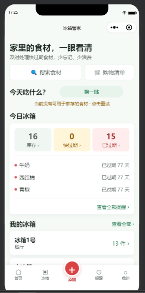
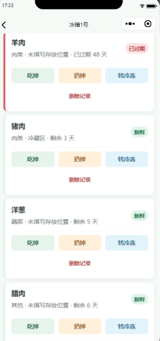
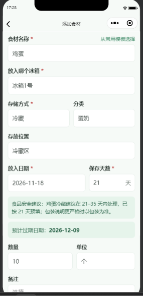
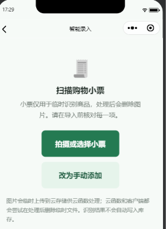
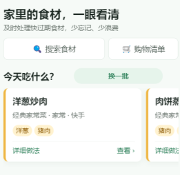

# AI-Powered Smart Fridge Mini Program
### 智能冰箱管家 · 微信小程序

A WeChat Mini Program for managing household food inventory, reducing food waste, and providing AI-assisted food recognition and recipe recommendations.

基于微信原生小程序与腾讯云 CloudBase 开发的智能冰箱管理应用，旨在解决家庭多个冰箱的食材管理、食品过期提醒及食材利用问题。

## ✨ Key Features

- **Shared Fridge Management:** 支持多个冰箱管理、家庭成员共享及访问权限控制。
- **Expiry Tracking:** 自动计算食材保质期，提供临期及过期提醒。
- **AI Food Recognition:** 通过图片识别食材，并支持购物小票 OCR 解析。
- **AI Recipe Recommendations:** 根据现有库存推荐菜谱，优先匹配本地菜谱，不足时调用 Qwen。
- **Inventory Management:** 支持食材搜索、数量更新、食用记录及浪费统计。

## 🛠 Tech Stack

- **Frontend:** WeChat Mini Program, JavaScript, WXML, WXSS
- **Backend:** Tencent CloudBase, Cloud Functions, Cloud Database
- **AI:** Qwen API, Multimodal Vision, OCR
- **Testing:** Node.js

## 🏗 Architecture

```text
WeChat Mini Program
        |
        v
Tencent CloudBase
        |
        +-- Cloud Database
        |     +-- Food inventory
        |     +-- Household permissions
        |     +-- Recipe cache
        |
        +-- Cloud Functions
              +-- Food recognition & OCR
              +-- Recipe recommendations
              +-- Expiry reminders
              +-- Household management
                      |
                      v
                  Qwen API
```

## 💡 Engineering Highlights

- **Access Control:** 使用 OpenID 和服务端权限验证，实现家庭成员共享及个人数据隔离。
- **Structured AI Output:** 对识别和 OCR 结果进行结构化解析与校验，用户确认后才导入库存。
- **Recipe Optimisation:** 使用 175 道本地菜谱优先匹配，并通过库存指纹缓存减少不必要的模型调用。
- **Food Safety:** 过滤已食用、已丢弃和过期食材，避免将其用于菜谱推荐。

## 📸 Screenshots
| Dashboard | Fridge Inventory | Add Food |
|:---:|:---:|:---:|
|  |  |  |

| AI Food Recognition | Receipt OCR | Recipe Recommendations |
|:---:|:---:|:---:|
|  |  |  |


---

## 1. 项目结构

```text
.
├─ miniprogram/
│  ├─ pages/
│  │  ├─ index/             首页 Dashboard
│  │  ├─ fridge/            冰箱列表、修改、删除
│  │  ├─ fridge-detail/     单个冰箱的食材
│  │  ├─ add-fridge/        新增/修改冰箱
│  │  ├─ add-food/          添加食材
│  │  ├─ food-detail/       食材详情、已食用、删除
│  │  ├─ reminders/         快过期/已过期列表
│  │  └─ profile/           用户信息与订阅授权
│  ├─ services/database.js  云数据库访问
│  ├─ utils/date.js         自然日日期计算
│  ├─ utils/foodStatus.js   统一食材状态计算
│  ├─ app.js / app.json / app.wxss
│  └─ config.js             云环境与订阅模板配置
├─ cloudfunctions/
│  ├─ login/                获取 openid、初始化 users
│  ├─ deleteFridge/         校验归属并安全级联删除
│  ├─ sendExpiryReminders/  每日检查并发送订阅消息
│  ├─ household/            Household 权限、邀请和共享库存
│  └─ smartFood/            Phase 3 智能能力与 Provider 边界
├─ tests/date-status.test.js
├─ package.json
└─ project.config.json
```

当前目录结构由 Phase 1–3 逐步演进；新增功能继续复用既有服务和权限边界。

## 2. 已完成的 MVP 功能

```text
[完成] 微信云身份登录与 users 初始化
[完成] 按 openid 查询和数据库安全规则双重用户隔离设计
[完成] 多冰箱新增、查看、修改、删除
[完成] 删除含食材冰箱前明确确认，云端级联删除
[完成] 添加食材与必填/数字/日期校验
[完成] 自动计算 expire_date
[完成] fresh / near_expiry / expired / consumed 统一动态计算
[完成] 首页冰箱数量、食材统计和优先提醒
[完成] 快过期 / 已过期提醒页
[完成] 食材详情、标记已食用、二次确认删除
[完成] 一次性订阅授权入口、定时发送云函数与发送去重记录
[完成] 日期和状态 20 项本地断言测试代码
```

Phase 3 的 AI 集成代码已提供，但真实识别、OCR、菜谱和知识问答必须先在 CloudBase 配置 Provider 与知识文档；未配置时 UI 会明确降级，不会伪造结果。

## 3. 数据库集合与字段

在云开发控制台创建下列基础及分阶段集合。`_id` 由数据库生成，前端新增个人数据时 `_openid` 由云数据库自动写入，共享库存通过云函数写入。

### `users`

```text
_id, _openid, openid, notification_enabled,
timezone_offset_minutes, timezone_updated_at,
created_at, updated_at, last_login_at
```

### `fridges`

```text
_id, _openid, name, location, created_at, updated_at
```

### `foods`

```text
_id, _openid, fridge_id,
name, category, storage_area, quantity, unit,
put_in_date, shelf_life_days, expire_date,
status, note, consumed_at, discarded_at, frozen_at,
created_at, updated_at
```

`status` 持久保存 `fresh`（创建时）、`consumed`（已食用）或 `discarded`（已扔掉）。新鲜、临期、过期状态在每次查询后根据当天日期动态计算，避免状态隔天失真。

前端使用设备本地自然日；用户打开“我的”页或订阅提醒时，会把 `Date#getTimezoneOffset()` 保存到 `users.timezone_offset_minutes`。提醒云函数按每位用户保存的偏移计算本地自然日，不再统一使用服务器或北京时间。旧用户尚无该字段时暂按 UTC+8 兼容，并在云函数日志中提示用户重新打开小程序或订阅。

### `reminders`

```text
_id, recipient_openid, openid, food_id, reminder_type,
local_date, scheduled_date, sent, status,
claimed_at, sent_at, created_at
```

`recipient_openid + food_id + local_date` 用于按接收用户本地自然日去重。`openid / scheduled_date` 暂时作为旧字段兼容别名继续写入。发送前会用确定性 `_id` 短暂写入 `sent=false, status=claimed` 防止并发重复；OpenAPI 失败时删除占位，成功后更新为 `sent=true, status=sent`。站内提醒不依赖此集合。

### `food_templates`（Phase 2）

```text
_id, _openid, name, category,
default_shelf_life_days, default_fridge_id, default_storage_area,
created_at, updated_at
```

### `shopping_items`（Phase 2）

```text
_id, _openid, name, category, quantity, unit,
purchased, purchased_at, created_at, updated_at
```

`shopping_items` 是个人数据，始终按 `_openid` 隔离，不随 Household 共享。历史记录中若已有 `household_id`，该字段会被忽略，不要求清库或批量删除。

### Household（Phase 2.5）

首次创建家庭前，请在 CloudBase 控制台新增：

```text
households
household_members
household_invites
fridge_members
```

第 1 步启用 `households` 与 `household_members`；邀请和指定成员共享会在后续步骤使用另外两个集合。

```text
households:
  _id, _openid, name, owner_openid, created_at, updated_at

household_members:
  _id, _openid, household_id, user_openid, role,
  joined_at, created_at, updated_at

fridges 新增:
  household_id, created_by, visibility

foods 新增:
  household_id

```

`visibility` 只允许 `private / household / selected`。旧冰箱缺少这些字段时，兼容语义为 `created_by = _openid` 且 `visibility = private`，不会因为创建家庭而自动公开。

Phase 2.5 MVP 目前按“一个用户同时只属于一个 Household”设计。`household_members` 使用基于当前用户身份生成的固定文档 ID 防止并发重复创建；部署到云环境后仍建议为 `user_openid` 建唯一索引，并为 `household_id + user_openid` 建查询索引。

`households`、`household_members` 以及后续的 `household_invites`、`fridge_members` 不应设置为“所有用户可读写”。客户端统一通过 `household` 云函数访问，建议安全规则禁止客户端直接写入；云函数会从微信上下文读取 openid 并执行服务端校验。

### Phase 3 智能功能集合

```text
smart_recipe_cache:
  _id, _openid, local_date, inventory_fingerprint,
  recipe, created_at

food_safety_documents:
  _id, title, organization, url, content,
  keywords[], active, updated_at
```

两个集合都只允许云函数读写。客户端不得直接读取知识库全文或写入菜谱缓存。`food_safety_documents` 只应导入经过人工审核的政府、公共卫生机构、大学 Extension 或其他权威机构资料；仓库中的 seed 不会自动写入数据库，导入前仍应人工审核来源与内容。

推荐索引：

- `fridges`：`_openid + created_at`
- `foods`：`_openid + fridge_id + expire_date`
- `foods`：`_openid + status + expire_date`
- `users`：`notification_enabled`
- `reminders`：`sent + scheduled_date`（提醒云函数按接收者可能涉及的本地日期批量读取）
- `reminders`：`recipient_openid + food_id + local_date + sent`
- `reminders`：保留旧索引 `openid + food_id + scheduled_date + sent` 兼容历史记录
- `smart_recipe_cache`：`_openid + local_date`
- `food_safety_documents`：`active`

## 4. 第一次运行：逐步配置

### 第一步：准备账号和工具

1. 在微信公众平台注册小程序并取得 AppID。
2. 安装最新版微信开发者工具。
3. 打开本目录，工具会读取根目录的 `project.config.json`。
4. 在“详情 → 基本信息”中把测试 AppID 换成自己的 AppID；也可直接修改 `project.config.json` 的 `appid`。

根目录测试不依赖第三方包，只需本机安装 Node.js 18 或更高版本。小程序前端本身不需要执行 `npm install`。

### 第二步：开通 CloudBase

1. 在开发者工具顶部点击“云开发”并开通环境。
2. 复制环境 ID。
3. 打开 `miniprogram/config.js`，把环境 ID 塹入：

```js
cloudEnv: '你的云环境 ID'
```

如果项目始终只关联一个默认云环境，也可暂时留空；明确填写更不容易误连环境。

### 第三步：创建集合和设置权限

在云开发控制台“数据库”中依次创建：

```text
users
fridges
foods
reminders
food_templates
shopping_items
```

`shopping_items`、`food_templates`、用户个人设置使用“仅创建者可读写”或等价 `_openid` 规则。Household、共享冰箱和共享食材的跨用户访问统一通过云函数校验，不要把相关集合设置为“所有用户可读写”。

不要把集合设为“所有用户可读”，否则仅靠前端查询条件无法构成可靠的数据隔离。

### 第四步：上传并部署云函数

在开发者工具左侧展开 `cloudfunctions`，分别右键以下目录，选择“上传并部署：云端安装依赖”：

```text
login
deleteFridge
sendExpiryReminders
household
smartFood
```

部署后先在云函数控制台手动运行 `login`，或直接编译小程序。打开小程序会自动调用 `login` 并创建用户记录。

### 第五步：配置订阅消息

1. 在微信公众平台进入“订阅消息”，从公共模板库选择一个食材到期提醒的一次性订阅模板。
2. 记录模板 ID，并确认模板关键词的字段名及类型。
3. 将同一个模板 ID 填入：
   - `miniprogram/config.js` 的 `expiryTemplateId`
   - `cloudfunctions/sendExpiryReminders/config.js` 的 `templateId`
4. “保质期到期提醒”模板字段已经固定为：`thing6` 食物名称、`number2` 剩余天数、`time16` 过期时间、`thing10` 位置、`thing3` 备注。
5. 当前 `miniprogramState` 为 `developer`，用于开发版联调；正式发布并重新部署云函数前改为 `formal`。
6. 重新上传并部署 `sendExpiryReminders`。
7. 在小程序“我的”页，由用户主动点击“开启过期提醒”。

重要限制：微信一次性订阅消息必须由用户主动授权，通常一次允许对应一次发送机会，不能无限主动推送。代码在成功发送后会关闭本地的 `notification_enabled` 标记；若要再次提醒，用户需要再次主动授权。最终能否发送还取决于模板审核状态、用户授权、版本状态和微信平台规则。

### 第六步：设置定时触发器

`sendExpiryReminders/config.json` 已声明每天 09:00 的定时触发器。部署后请在云函数控制台检查触发器是否随部署创建；若未创建，手动添加名为 `daily-expiry-reminder` 的定时触发器，Cron 配置为：

```text
0 0 9 * * * *
```

云函数按 `users.timezone_offset_minutes` 计算每位用户的本地自然日。第一次联调应从开发版小程序“我的”页点击测试按钮触发，不能把 CloudBase 控制台云端测试当作微信 OpenAPI 成功验证方式。

## 5. 核心业务流程

```text
打开小程序
→ login 云函数取得 openid 并初始化用户
→ Household 云函数计算当前用户可访问的 private / household / selected 冰箱
→ 加载这些冰箱中的未食用食材
→ 根据 expire_date 和当天自然日动态计算状态
→ 首页显示冰箱、统计与优先提醒
→ 0～2 天内到期进入“快过期”，小于 0 天进入“已过期”
→ 用户标记“已食用”后 status = consumed
→ 已食用食材退出库存、统计和提醒
```

订阅链路：

```text
用户主动点击授权
→ users.notification_enabled = true
→ 每日云函数按每位已订阅用户的冰箱访问权限筛选食材
→ 按接收用户自己的时区计算本地自然日和 0～2 天候选
→ 按“最早过期”优先发送一条
→ reminders 记录成功发送，防止当天重复
→ 一次性授权消费后等待用户下次主动授权
```

## 6. 测试

### 自动测试

本机安装 Node.js 18 或更高版本后，在项目根目录执行：

```bash
npm test
```

测试覆盖今天、明天、2 天后、3 天后、昨天、跨月、跨年、闰年、无效日期以及四种状态。自动测试只验证纯业务逻辑，不代表云环境、AppID 或订阅消息已经配置成功。

### 2026-08-24 手工测试数据

先创建“厨房冰箱”和“冷冻柜”，再向厨房冰箱添加：

| 食材 | 放入日期 | 保存天数 | 到期日 | 预期状态 |
|---|---:|---:|---:|---|
| 豆腐 | 2026-08-21 | 3 | 2026-08-24 | 今天到期 / 快过期 |
| 菠菜 | 2026-08-22 | 3 | 2026-08-25 | 剩余 1 天 / 快过期 |
| 牛奶 | 2026-08-24 | 5 | 2026-08-29 | 剩余 5 天 / 新鲜 |
| 鸡肉 | 2026-08-17 | 5 | 2026-08-22 | 已过期 2 天 / 已过期 |

验证步骤：

1. 首页应显示：新鲜 1、快过期 2、已过期 1。
2. 提醒页应有豆腐、菠菜和鸡肉，不应有牛奶。
3. 把豆腐标记“已食用”，它应立即退出库存、首页统计和提醒页。
4. 分别在两个冰箱添加同名“鸡蛋”，两条记录应互不影响。
5. 删除有食材的冰箱，应看到含记录数量的二次确认。
6. 使用另一个微信测试账号打开，默认不应看到第一个账号的数据。

### 尚需真机/云端验证

- AppID 对应的小程序能否正常调用已部署云函数。
- 自定义数据库权限是否按上述规则生效。
- 订阅模板字段名、审核状态及用户授权额度是否可用。
- 定时触发器是否在目标云环境正常运行。
- 订阅消息是否能在目标版本状态（开发/体验/正式）送达。

这些项目依赖你的微信后台和 CloudBase 环境；当前仓库提供了代码和配置入口，但不能在本机伪装成已验证成功。

## 7. Phase 2 功能与配置

Phase 2 在 Phase 1 数据模型上增量增加：

- 固定食材分类、旧分类兼容和冰箱分类筛选
- 跨冰箱当前库存搜索
- 吃掉、扔掉、转冷冻生命周期操作
- 常用食材模板 CRUD 和新增食材预填
- 购物清单、已购买和快速加入冰箱
- 首页动态每日冰箱总结
- 用户模板优先、内置规则次之的智能预填

升级时只需在 CloudBase 新建 `food_templates`、`shopping_items` 两个集合，并同样设置为“仅创建者可读写”。不要清空或迁移原有 `foods`。`discarded_at`、`frozen_at` 是操作发生后才出现的可选字段；旧记录没有这些字段仍能正常工作。

Phase 2 新增页面：

```text
pages/search
pages/freeze-food
pages/food-templates
pages/edit-template
pages/shopping
pages/add-shopping
```

新增食材和 Vision/OCR 导入确认页的统一保存规则位于 `miniprogram/utils/foodShelfLifeRules.js`。分类、推荐天数、建议范围和提示文案都从该文件生成；`defaultFoods.js` 仅作为 Phase 2 兼容入口，不再独立维护规则。模板匹配优先于精确食材规则，其次是分类参考；所有建议天数都允许用户在保存前修改。旧 `smartFood.recommendShelfLife` 及其云端规则仅保留旧调用兼容，当前页面不再调用，也不再用 Qwen 生成保存建议文案。

## 8. Phase 2.5 第 1 步：家庭数据模型与懒迁移

部署 `household` 云函数并创建 `households`、`household_members` 集合后，前端可调用 `miniprogram/services/household.js` 创建家庭。创建过程会在服务端写入 Household 和 owner 成员，再幂等迁移创建者的旧数据：

```text
旧 fridges      → 补 household_id / created_by / visibility=private
冰箱下 foods    → 补 household_id
```

迁移只补缺失字段，不覆盖已存在的 Household 归属。若家庭创建成功但批量迁移中断，可由 owner 调用 `migrateOwnedData()` 重试。`shopping_items` 最终确定为个人数据，不再参与 Household 迁移；历史记录中若已存在 `household_id`，业务代码会直接忽略该遗留字段。

## 9. Phase 2.5 第 2 步：家庭页面

“我的”页新增“我的家庭”入口，页面支持创建家庭、查看成员和本人角色、owner 修改名称/移除普通成员、member 二次确认后退出。邀请按钮目前只显示后续阶段提示。

敏感操作统一调用 `household` 云函数的以下 action，并以云函数微信上下文中的 openid 做服务端校验：

```text
getContext
createHousehold
updateHouseholdName
removeMember
leaveHousehold
```

Step 2 仍未开放共享冰箱查询，也没有修改库存、购物清单和订阅提醒逻辑。更新代码后需要重新上传并部署 `cloudfunctions/household`。

## 10. Phase 2.5 Step 3/4：冰箱权限与家庭邀请

创建 `fridge_members`、`household_invites` 后，冰箱和食材读写统一通过 `household` 云函数校验。冰箱权限为：

```text
private   → 仅 created_by
household → created_by + 当前 Household 全部有效成员
selected  → created_by + fridge_members 明确选择的有效成员
```

`fridge_members` 结构：

```text
_id, _openid, fridge_id, household_id, user_openid,
permission='editor', created_at
```

`household_invites` 结构：

```text
_id, _openid, household_id, invite_token, created_by,
expires_at, status, qr_file_id, created_at, revoked_at
```

邀请 token 使用安全随机数生成，有效期集中配置为 24 小时，可供多人加入，也可以由 owner 撤销。微信转发路径只携带 token。邀请二维码使用同一 token 调用 `wxacode.getUnlimited` 生成小程序码并保存到云存储，配置位于 `cloudfunctions/household/config.js`；开发联调默认 `qrEnvVersion='develop'`，发布前必须根据目标版本调整。

需要重新部署：

```text
cloudfunctions/household
cloudfunctions/deleteFridge
```

建议索引：

```text
fridge_members: fridge_id + user_openid（唯一）
fridge_members: user_openid
household_invites: invite_token（唯一）
household_invites: household_id + status
fridges: household_id + visibility
foods: fridge_id + expire_date
```

两个新集合都不应允许客户端直接写入。`shopping_items` 最终保持个人数据，不进入 Household 共享。

## 11. Phase 2.5 Step 6：Household 到期提醒

`sendExpiryReminders` 会批量加载已订阅用户、Household 成员关系、selected 成员、冰箱、食材和当日本地提醒记录，然后在内存中按与库存服务一致的权限规则筛选：

```text
private   → 仅冰箱创建者
household → 创建者 + 当前 Household 有效成员
selected  → 创建者 + 被选择的当前 Household 有效成员
```

冰箱可访问只是候选资格，每位接收者仍需自行授权一次性订阅并保持个人 `notification_enabled=true`。同一个 food 会按每位接收者自己的 `timezone_offset_minutes` 分别计算 `local_date` 和 `remainingDays`，只发送 0～2 天且未 consumed/discarded/expired 的食材。去重维度为接收者、food、提醒类型和接收者本地日期。

最终数据边界：

```text
Household-aware:
  fridges, foods, 首页库存、搜索、总结、到期提醒访问资格

Personal:
  shopping_items, food_templates,
  notification_enabled, timezone_offset_minutes, timezone_updated_at
```

## 12. Phase 3：报告与智能功能

### 页面与流程

```text
首页快捷添加
├─ 手动添加
├─ 拍照识别 → smart-capture → import-review → Household 批量写入
└─ 扫描小票 → OCR → 商品行过滤 → import-review → Household 批量写入

首页今天吃什么
└─ smartFood 读取当前用户 accessible foods → 菜谱缓存 → recipe 详情

我的
├─ 冰箱报告
└─ 食品安全助手
```

图片识别和小票 OCR 共用 `smartFood` 云函数的 Vision Provider。图片先上传到 `smart-temp/`，云函数在 `finally` 中删除，客户端也会做兜底删除。识别结果必须进入确认页；AI 不直接写数据库。确认页单次最多导入 20 项，统一调用 `household.batchCreateFoods`，云函数重新校验目标冰箱的 private / household / selected 权限并使用事务写入。

菜谱云函数只向 Provider 发送食材名称和 `remaining_days`，不发送 openid、Household ID、成员或数据库 ID。expired、consumed、discarded 严格排除。缓存键由接收用户、本地自然日和可访问库存指纹生成；库存或权限变化会产生新指纹。

食品安全问答当前默认使用 `llm_only`：问题直接交给已配置的文本模型，返回简短、保守且不伪造官方来源的通用建议，不查询 `food_safety_documents`。原有 RAG 检索、HTTPS host 白名单和来源验证代码仍保留；将 `FOOD_SAFETY_MODE` 显式设为 `rag` 后可恢复“最多 3 个资料片段 → LLM → sourceIds 验证”的流程。

当前新增食材页和 Vision/OCR 导入确认页的保存时间推荐顺序为：

```text
个人 food_template
→ foodShelfLifeRules 精确名称/别名规则
→ 未匹配时不自动填写
```

同一个规则结果同时提供分类、`recommendedDays`、建议范围、`safety/quality` 类型和提示文案，预计到期日再由现有自然日工具根据该天数计算。旧 `smartFood.recommendShelfLife` 的模板/历史/fallback 逻辑仅保留兼容，当前页面不再调用，避免其 3 天通用 fallback 或 Qwen 解释与表单天数冲突。

### AI Provider 配置

默认实现位于 `cloudfunctions/smartFood/providers/`，当前使用可替换的 HTTPS、OpenAI-compatible Chat Completions JSON 协议适配器。可选择在中国大陆及 CloudBase 网络环境中稳定可用、支持图片输入和 JSON 输出的服务商；业务页面不依赖厂商名称。若服务商协议不同，只需替换 providers 内实现并保持标准返回结构。

在 `smartFood` 云函数环境变量中配置：

```text
SMART_FOOD_PROVIDER_NAME        Provider 展示名称
SMART_FOOD_API_URL              百炼 OpenAI-compatible Base URL
SMART_FOOD_API_KEY              仅云函数保存的 API Key
SMART_FOOD_MODEL                可选，仅保留为 Vision/Text 旧配置兼容值
SMART_FOOD_VISION_MODEL         可选，单独指定图片模型
SMART_FOOD_OCR_MODEL            必填，单独指定购物小票 OCR 模型，不回退到 Vision
SMART_FOOD_TEXT_MODEL           可选，单独指定菜谱/问答文本模型
SMART_FOOD_TIMEOUT_MS           可选，默认 25000
SMART_RECIPE_CACHE_COLLECTION   可选，默认 smart_recipe_cache
FOOD_SAFETY_COLLECTION          可选，默认 food_safety_documents
FOOD_SAFETY_MODE                可选，当前默认 llm_only；设为 rag 可恢复知识库检索与来源验证
FOOD_SAFETY_ALLOWED_HOSTS       逗号分隔的权威来源域名白名单
```

当前确定使用阿里云百炼 Qwen 时，模型变量应配置为：

```text
SMART_FOOD_PROVIDER_NAME=aliyun-bailian-qwen
SMART_FOOD_VISION_MODEL=qwen3.8-27b
SMART_FOOD_OCR_MODEL=qwen-vl-ocr
SMART_FOOD_TEXT_MODEL=qwen3.7-flash
```

`SMART_FOOD_MODEL` 仅作为旧配置对 Vision/Text 的兼容 fallback；OCR 为避免误用通用视觉模型，必须明确填写 `SMART_FOOD_OCR_MODEL`。`SMART_FOOD_API_URL` 和 `SMART_FOOD_API_KEY` 仍按百炼兼容接口配置在云函数环境变量中。

华北 2（北京）工作空间应把 `SMART_FOOD_API_URL` 配置为 Base URL：

```text
https://{WorkspaceId}.cn-beijing.maas.aliyuncs.com/compatible-mode/v1
```

Provider 会安全追加一次 `/chat/completions`。为兼容已有环境，填写完整 endpoint 也可以；代码检测到末尾已经是 `/chat/completions` 时不会重复追加，并会拒绝 `/v1/v1` 或 `/chat/completions/chat/completions` 等重复路径。

不要把 API Key 写入 `miniprogram/`、README 或 Git。当前仓库没有真实 Key，也没有 mock 成功结果；未配置时拍照/OCR/菜谱会显示待配置，保存时间则回退到本地规则，食品安全助手明确无法基于权威资料回答。

### 导入中国食品安全知识 seed

seed 固定放在项目的 `data/food_safety_seed_cn.json`。导入器是仅供开发/管理使用的 Node 脚本，不会从小程序客户端写数据库，也不会改写 seed 文件。它会先校验必填字段、HTTPS URL 和 seed 自带的 `recommended_allowed_hosts`，再按 `_id` 生成幂等计划：不存在则新增、内容变化则更新、完全一致则跳过；不会删除集合中的其他文档。

先安装根目录开发依赖：

```powershell
npm install
```

仅验证本地 seed，不连接 CloudBase：

```powershell
npm run food-safety:validate
```

在 PowerShell 中设置目标环境和服务端 API Key。API Key 必须属于目标环境并具备文档型数据库读写权限；不要把 Key 写入仓库或前端：

```powershell
$env:CLOUDBASE_ENV_ID = 'cloud1-d9g1cde0xd06b6126'
$foodSafetyKey = Read-Host 'CloudBase server API key' -AsSecureString
$env:CLOUDBASE_APIKEY = [Net.NetworkCredential]::new('', $foodSafetyKey).Password
```

`CLOUDBASE_APIKEY` 必须是控制台复制的单行原始 Server ApiKey：不要添加 `Bearer ` 前缀，不要传 JSON、SecretId/SecretKey 组合或其他多字段 credential。导入器初始化时只传环境 ID，`@cloudbase/node-sdk` 会自动读取 `CLOUDBASE_APIKEY` 并构造 Authorization header。可先运行不联网的安全诊断；它只显示是否存在、长度以及 CR/LF/首尾空白，不输出 Key：

```powershell
npm run food-safety:credential
```

先执行 dry-run；第一次导入 20 条全新 seed 时应显示 `create: 20, update: 0, skip: 0`：

```powershell
npm run food-safety:dry-run
```

确认目标环境和统计无误后再写入：

```powershell
npm run food-safety:import
```

验证全部 seed 文档已经存在且内容一致；成功时显示 `expected: 20, matched: 20, missing: 0, different: 0`：

```powershell
npm run food-safety:verify
```

操作结束后清除当前终端中的凭据：

```powershell
Remove-Item Env:CLOUDBASE_APIKEY
Remove-Variable foodSafetyKey
```

`food_safety_documents` 集合需要预先存在并保持“仅云函数/服务端可写”。导入按文档 `_id` 直接查询和写入，不需要额外业务索引；现有 `active` 索引继续供 smartFood 检索使用。若使用自定义集合名，可临时设置 `FOOD_SAFETY_COLLECTION`，否则默认写入 `food_safety_documents`。

导入后还要确认 `smartFood` 云函数环境变量包含 seed 推荐的来源 host，否则运行时安全检索会过滤相应文档：

```text
FOOD_SAFETY_ALLOWED_HOSTS=nhc.gov.cn,www.nhc.gov.cn,samr.gov.cn,www.samr.gov.cn
```

### 云存储和隐私

- 允许已登录小程序用户向随机名称的 `smart-temp/` 路径上传临时图片，但不要开启公共列表或永久公共读。
- `smartFood` 云函数需要以云端身份下载和删除这些文件。
- 冰箱照片用于识别可见食材；购物小票用于 OCR 和商品行解析；两者不建立历史图片 collection。
- 小票可能含会员号、交易号等隐私，Provider 只应按合同和隐私要求临时处理，不用于训练或长期保存。
- 菜谱仅发送最小库存摘要；API Key 只存在云函数环境变量。

### 部署顺序

1. 创建 `smart_recipe_cache`、`food_safety_documents` 并设置为仅云函数访问。
2. 配置云存储临时上传规则和生命周期清理策略，生命周期作为异常删除失败的兜底。
3. 配置并部署 `smartFood`，选择“云端安装依赖”。建议在 CloudBase 控制台将函数超时设置为 30–60 秒；Provider 内部请求仍会在默认 25 秒主动超时。
4. 重新部署 `household`，启用 `batchCreateFoods`。
5. 上传新的小程序开发版。
6. 先用非敏感测试图片和经过审核的少量知识文档完成真机验收，再逐步开放真实用户。
